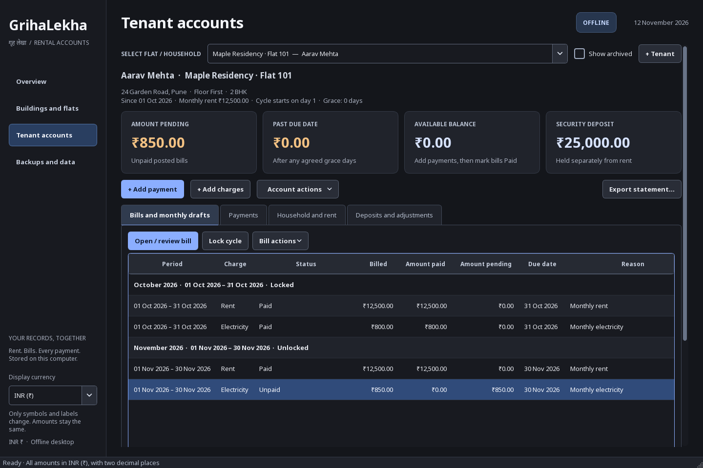
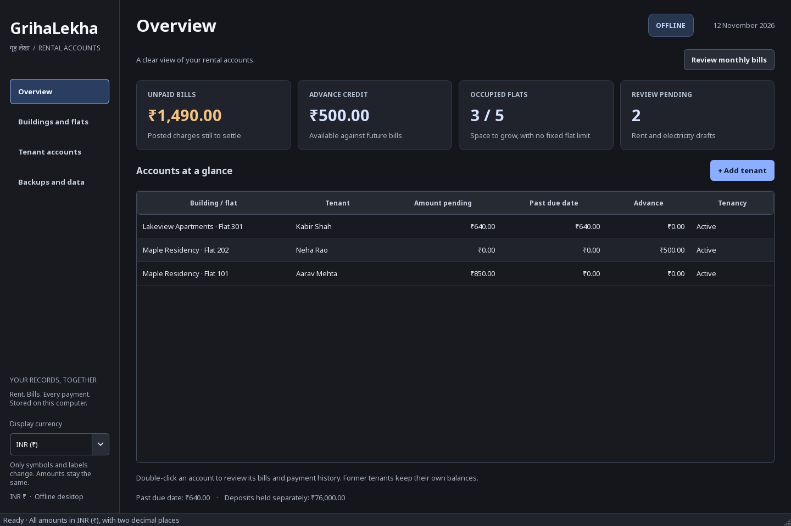
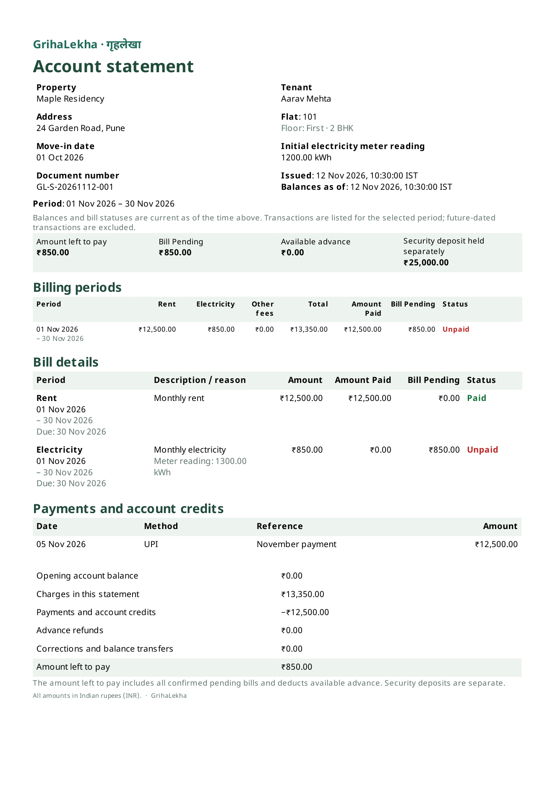

<p align="center">
  
</p>

# GrihaLekha

**Offline rent and tenant accounts for Windows and Linux.**

[](https://github.com/iamokish/GrihaLekha/actions/workflows/check.yml)
[](LICENSE)
[](https://github.com/iamokish/GrihaLekha/blob/main/pyproject.toml)

Manage buildings, flats, households, rent, electricity, payments, and deposits
from one desktop application. GrihaLekha keeps your records on your computer
and produces statements in English, Hindi, or both. No account, subscription,
server, or internet connection is needed to use it.

[Download](https://github.com/iamokish/GrihaLekha/releases) ·
[User guide](USER_GUIDE.md) ·
[Changelog](CHANGELOG.md) ·
[Build guide](https://github.com/iamokish/GrihaLekha/blob/main/packaging/README.md) ·
[Report a bug](https://github.com/iamokish/GrihaLekha/issues/new?template=bug_report.yml)



*All screenshots and statement examples use demonstration data.*

## What it does

- **Properties and households:** organize buildings and flats, household
  members, agreed rent, billing days, and dated occupancy history.
- **Monthly billing:** review rent and electricity before posting. Record
  optional meter readings or carry deferred electricity into a later bill.
- **Payments and balances:** record receipts and proofs, then pay individual
  bills from the available balance. Keep refundable deposits separate.
- **Corrections with history:** correct bill amounts, return applied payments
  to balance, record refunds, and protect payment changes with cycle locks.
- **Tenant changes:** handle rent changes, flat moves and exchanges, departures,
  upcoming-tenancy cancellation, and settled-account archival.
- **Statements and receipts:** export PDFs in English, Hindi, or both, and CSV
  tables for spreadsheets. Fonts are bundled for offline use.
- **Complete backups:** save the database, payment proofs, and issued documents
  together; restore them on another computer.

Amounts use exact integer arithmetic. INR (₹) is the default display currency;
USD ($), EUR (€), JPY (¥), GBP (£), CAD (C$), AUD (A$), SGD (S$), and NZD (NZ$)
are also available. Changing currency changes only symbols and labels. Amounts,
digit grouping, and two decimal places stay the same, including for JPY.



## Download and install

Open [Releases](https://github.com/iamokish/GrihaLekha/releases) and choose the
package for your operating system. Release packages target **x86-64 (x64)**.
Python is included; you do not need to install it separately.

| System | Package | Installation |
| --- | --- | --- |
| Windows 11 | `GrihaLekha-VERSION-windows-x64-setup.exe` | Run the per-user installer. |
| Windows 11, portable | `GrihaLekha-VERSION-windows-x64-portable.zip` | Extract the folder and open `GrihaLekha.exe`. |
| Debian 12+ / Ubuntu 22.04+ | `grihalekha_VERSION_amd64.deb` | Run `sudo apt install ./grihalekha_VERSION_amd64.deb`. |
| Arch Linux | `grihalekha-VERSION-1-x86_64.pkg.tar.zst` | Run `sudo pacman -U ./grihalekha-VERSION-1-x86_64.pkg.tar.zst`. |
| Linux, portable | `GrihaLekha-VERSION-linux-x64-portable.tar.gz` | Extract the archive, then run `GrihaLekha/GrihaLekha`. |

Replace `VERSION` with the release version, such as `0.1.0`. Keep portable
application folders intact. Linux portable builds need the desktop libraries
listed in the [build guide](https://github.com/iamokish/GrihaLekha/blob/main/packaging/README.md#linux). Arch is a rolling
distribution; consult the release notes for the tested environment.

Each release includes `SHA256SUMS.txt`. Verify downloaded files with
`sha256sum --check --ignore-missing SHA256SUMS.txt` on Linux, or compare
`Get-FileHash .\FILENAME -Algorithm SHA256` with the checksum on Windows.

## First account

1. Add a building and its flats under **Buildings and flats**.
2. Add a tenant, including the move-in date, monthly rent, and billing day.
3. Enter opening balances if you are bringing existing records into the app.
4. Review the monthly rent and electricity bills, then add payments as received.
5. Open a bill and choose **Mark Paid from Balance** to pay it.

Receiving money adds available balance; it does not automatically pay bills.
Deposits remain separate until you explicitly transfer them. Partial first or
final rent is entered as an agreed amount, without automatic proration.
See the [user guide](USER_GUIDE.md) for the complete workflow.

## Statement example

Statements show the selected period's activity, each billing cycle's status,
current amount left to pay, available balance, and deposits. Accounting dates
and issue times use India Standard Time. Changing the report language translates
labels; names and notes remain as entered.

<p align="center">
  <a href="docs/images/statement.png"></a>
</p>

The default Chromium renderer produces searchable Hindi PDFs. If it cannot
start, the app uses native Qt printing; Hindi search and copy may be less
accurate in that fallback. Already issued documents are preserved.

## Your data

| Platform | Default account folder |
| --- | --- |
| Windows | `%LOCALAPPDATA%\GrihaLekha` |
| Linux | `$XDG_DATA_HOME/grihalekha`, normally `~/.local/share/grihalekha` |

Portable packages use the same locations. Pass `--data-dir /path/to/accounts`
to choose another folder. Only one app instance may open a folder at a time.

Complete ZIP backups contain the database, payment proofs, issued documents,
and saved currency preference. The app retains the latest two managed backups;
manual exports are independent. Use backup and restore to move records between
computers. Older supported databases upgrade after a verified safety snapshot.
Uninstalling the app leaves the separate account folder in place.

Keep the live database on a local disk. Backups can be copied to external or
synchronized storage. Account files and backups are not encrypted by the app.
See [security and data safety](SECURITY.md).

## Run from source

Install [uv](https://docs.astral.sh/uv/getting-started/installation/) and Git:

```sh
git clone https://github.com/iamokish/GrihaLekha.git
cd GrihaLekha
uv sync --locked --extra dev --python 3.12
uv run --frozen python -m grihalekha
```

Python 3.12–3.14 is supported. Standalone release builds use Python 3.12 and
Nuitka. For development, use a separate account folder:

```sh
uv run --frozen python -m grihalekha --data-dir .data/development
```

## Development and builds

Read [CONTRIBUTING.md](https://github.com/iamokish/GrihaLekha/blob/main/CONTRIBUTING.md) for setup and tests,
[the architecture guide](https://github.com/iamokish/GrihaLekha/blob/main/docs/ARCHITECTURE.md) for module boundaries and financial
invariants, and [the service contract](https://github.com/iamokish/GrihaLekha/blob/main/docs/API_CONTRACT.md) for internal APIs.

[packaging/README.md](https://github.com/iamokish/GrihaLekha/blob/main/packaging/README.md) documents `build.py`, prerequisites,
compiler options, verification, and packaging. [Releasing](https://github.com/iamokish/GrihaLekha/blob/main/docs/RELEASING.md)
explains version tags and the release workflow. GitHub Actions checks Windows
and Linux, verifies compiled applications and installers, and prepares draft
releases using the matching entry in [CHANGELOG.md](CHANGELOG.md).

To regenerate the documentation images from demonstration data:

```sh
uv run --frozen python scripts/generate_screenshots.py
```

## License

Copyright © 2026 [iamokish](https://github.com/iamokish).

GrihaLekha's original code and artwork are licensed under the
**GNU Affero General Public License, version 3 or later (AGPL-3.0-or-later)**.
See [LICENSE](LICENSE). Bundled dependencies and fonts retain their own
licenses; see [THIRD_PARTY_NOTICES.md](THIRD_PARTY_NOTICES.md).
