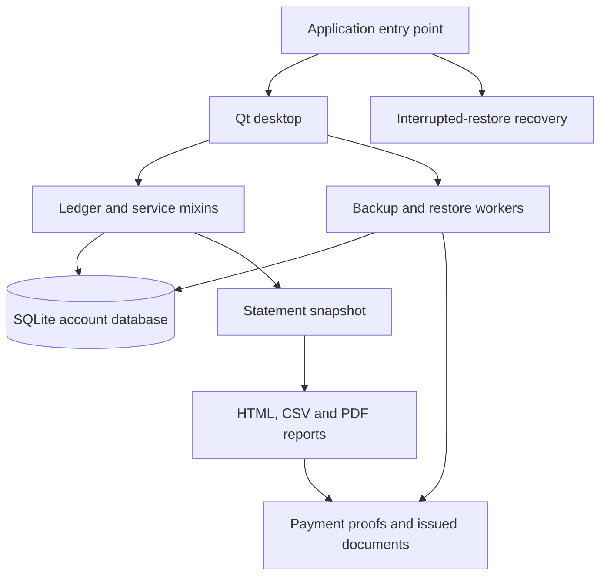

# Architecture and maintenance guide

GrihaLekha is an offline desktop application for tenancy accounts, defaulting to INR. It
uses Python, PySide6/Qt Widgets and SQLAlchemy Core over a local SQLite database.
There is no application server or hosted account service. The desktop and
packaged entry points use the same application code.

This guide describes the current implementation. See the
[internal service contract](API_CONTRACT.md) for method arguments and return
values, the [user guide](../USER_GUIDE.md) for daily operations, and the
[packaging guide](../packaging/README.md) for distribution details.

## Code map

All application modules are under `src/grihalekha/`.

| Module | Responsibility |
| --- | --- |
| `__main__.py` | Command-line arguments, QApplication, fonts/icons, data-folder lock, logging, startup recovery and smoke checks. |
| `paths.py` | User-data locations and asset lookup in source checkouts and installed packages. |
| `currencies.py` | Immutable supported display currencies and strict code validation. |
| `money.py` | Exact integer-paise validation, amount parsing and Indian digit grouping. |
| `meter.py` | Optional exact integer hundredths of kWh; independent of monetary amounts. |
| `dates.py`, `clock.py` | Stable monthly billing anchors, occupied periods and India Standard Time. |
| `models.py` | SQLAlchemy table definitions, constraints and supported schema versions. |
| `migrations.py` | Verified pre-upgrade SQLite snapshots and transactional schema upgrades. |
| `ledger.py` | Database connections/transactions, properties, tenancies, rates, charges, receipts, allocations, refunds, deposits, balances and statement snapshots. |
| `billing.py` | Monthly electricity drafts, bill-cycle grouping, payment locks, receiving balance and marking bills paid/unpaid. |
| `bill_corrections.py` | Linked amount corrections, replacement bills and restoration of legacy cancelled bills. |
| `lifecycle.py` | Dated flat occupancy, transfers/exchanges, move-out corrections and account archiving. |
| `tenancy_cancellation.py` | Preview and cancellation of never-started tenancies, reservation release, and retained settlement accounts. |
| `deposit_transfers.py` | Receipt-funded balance-to-deposit transfers, source availability/reversal guards, and statement adjustments. |
| `tenancy_deletion.py` | Reviewed exports and permanent deletion of a settled archived account. |
| `statement_cycles.py` | Read-only monthly statement summaries, including missing required reviews. |
| `reports.py` | Localized HTML, CSV, Chromium PDF rendering and native Qt PDF fallback. |
| `backups.py` | Complete backup ZIPs, validation, retention, staged restore and interrupted-restore recovery. |
| `ui/window.py` | Main window, selection/refresh state, service calls and export/backup workers. |
| Other `ui/` modules | Dialogs, bill tables, calendar, shared widgets and theme. |

`Ledger` combines six service mixins: `BillCorrectionMixin`, `BillingMixin`,
`LifecycleMixin`, `TenancyDeletionMixin`, `TenancyCancellationMixin`, and
`DepositTransferMixin`. They share the ledger's transaction
helpers and tables; they are not independently initialized services. Financial
validation belongs in this service layer so that callers outside the desktop
cannot bypass it. UI callbacks translate service failures into visible messages.



## Accounting invariants

- Money retains integer paise (hundredths) internally for every display currency.
  Inputs must not silently round floats or
  accept fractions smaller than one paise. A missing draft amount is different
  from an explicitly reviewed zero.
- Receipts and charges are separate records. Receiving money increases available
  balance; posting a bill does not spend it. Marking a bill Paid explicitly
  allocates enough available money to cover its entire remaining amount.
- New partial bill payments are rejected. Existing partial-allocation history
  remains readable and must survive upgrades and corrections.
- Unapplied balance and refundable security deposits are separate. Applying a
  deposit is an explicit transfer into account balance, not another cash receipt.
- Moving available balance into a deposit links the internal deposit movement
  to its original receipt sources. Those amounts cannot also fund bills,
  refunds, or another transfer. Backdated availability considers later uses and
  reversals. A funding receipt cannot be reversed while its transfer is active;
  reversing the transfer restores source credit only when deposit history permits.
- Corrections use dated reversals and linked replacement records. Payment
  allocation checks consider later history as well as the chosen effective date
  so a backdated operation cannot overspend funds already used later.
- Every occupied account cycle requires reviewed rent and electricity, or an
  explicit electricity deferral covered by a later bill. Uncovered deferrals
  prevent archival. Deferrals carry no amount or meter reading. Required
  bills cannot be publicly cancelled or deleted; amount corrections can set
  their reviewed amount to zero. Miscellaneous bills may be cancelled or hidden
  by deletion while preserving their underlying financial history.
- Unpaid miscellaneous bills can be corrected through the same linked
  replacement mechanism. Fees with applied money must first be marked Unpaid.
  Existing paid rent/electricity corrections release their applied funds into
  balance; correcting a bill never silently repays its replacement.
- Cycle locks protect affected payment and correction operations. Archived
  accounts are read-only until reopened. Services enforce these rules even when
  an action is also disabled in the UI.
- Accounts belong to tenancies, not flats. Transfers and exchanges retain each
  household's account and dated occupancy history. Occupancy may not overlap in
  the same flat. Transfer rent begins on a full billing-cycle boundary; partial
  first/final rent requires a chosen amount rather than automatic proration.
- Archiving requires departure, reviewed required bills and zero unpaid bills,
  available balance and deposits, including checks against future dated history.
  Permanent archived-account deletion is a separate, explicitly reviewed action.
- A never-started tenancy may instead be cancelled before its move-in date.
  Cancellation releases reservations without erasing occupancy, receipt, or
  deposit history. It stops nonopening rent/electricity for that stay and future
  drafts; miscellaneous fees and opening dues remain settlement items. Once
  settled, the account can be archived. Reopening it retains cancellation and
  cannot reclaim a flat or resume billing. Rebooking requires a new tenancy.

Billing anchors retain their original day through short months. For example,
an anchor of 31 clamps to February's final day, then returns to 31 in March.
Service periods have inclusive start/end dates; move-out records the last
occupied day. User-facing accounting dates use IST, while audit creation
timestamps use UTC.

Statements distinguish the selected period from the balance cutoff. By default,
balances and payment status reflect generation time in IST even when the report
period ends in the past. The selected period's movements reconcile separately:

```text
opening balance + charges - payments + refunds + adjustments
    = period closing balance
```

An explicit `as_of` selects a historical accounting cutoff. Newly generated
tenant documents omit deleted miscellaneous-bill details even at historical
cutoffs; a consolidated adjustment retains the exact financial reconciliation.
Previously issued documents and raw ledger history are not rewritten.

## Storage and transaction lifecycle

Display currency is scoped to the account folder using a `currency_code`
key/value row in the existing `settings` table. Missing or unsupported saved codes read
as INR; selecting a supported code validates and saves it atomically, with an
audit entry and revision increment for backup scheduling. No schema migration
or financial-row updates are involved. Backups carry the setting automatically.
The desktop reloads it after restore, and statement snapshots capture it inside
their read transaction. Renderers use that captured value, so later selections
cannot alter a snapshot or an already issued document. No process-global
currency state is used.

INR, USD, EUR, JPY, GBP, CAD, AUD, SGD, and NZD share the same scale of 100,
Indian digit grouping, and exactly two decimal places. Only symbols, currency
labels, and CSV money-column suffixes vary; there is no conversion or automatic
rounding for JPY. Existing `*_paise` names and INR CSV column names are retained.

The default account folder is `%LOCALAPPDATA%\GrihaLekha` on Windows and
`$XDG_DATA_HOME/grihalekha` on Linux, falling back to
`~/.local/share/grihalekha`. `--data-dir` selects an independent account folder.
Portable packages still use these user-data locations by default.

```text
account folder/
  grihalekha.sqlite3       live database
  grihalekha.sqlite3-wal   SQLite write-ahead log, when present
  grihalekha.sqlite3-shm   SQLite shared-memory state, when present
  application.lock        held while the desktop opens this folder
  attachments/            copied payment proofs
  documents/              issued documents
  backups/                latest two managed complete ZIP backups
  migration-backups/      verified snapshots before schema upgrades
  logs/                    rotating application logs
  recovery-*/             preserved files when a restore needs recovery
  restore-state.json      journal present during a restore
```

The desktop holds a `QLockFile` for the data folder. Within `Ledger`, an `RLock`
serializes writes, SQL writes use `BEGIN IMMEDIATE`, and failures roll back the
transaction. Connections enable foreign keys, a 15-second busy timeout and
`synchronous=FULL`; the database uses WAL. Read operations use explicit SQLite
transactions for consistent snapshots. Successful audited mutations also
increment a revision stored in `settings`.

Schema version 6 is current. It adds nullable initial and bill meter readings,
a boolean electricity deferral marker, and an indexed self-reference linking
deferred charges to their later combined charge. Readings are integer hundredths
of kWh and never enter balance calculations. A deferred bill retains its draft
financial status and monthly anchor. Derived coverage dates describe the combined
service period without moving the later bill into an earlier accounting cycle.
Amount corrections retain readings and transfer coverage to replacements;
voided combined bills leave earlier occupied deferrals unresolved. Existing
accounts receive no invented readings or deferrals. New empty databases receive
the current schema.
Supported versions 1, 2, 3, 4, and 5 are checked and upgraded after SQLite's online
backup API creates a verified snapshot, including committed WAL contents.
Unrecognized, incomplete, corrupt or newer schemas are rejected. Startup does
not replace a damaged database with an empty account.

Transfer creation inserts the deposit and all source links in one transaction.
Balance and receipt-availability reads subtract active source amounts at the
requested cutoff. Statement adjustments represent the account-side transfer
and reversal; cash receipts and refund totals remain unchanged. Backup validation
checks that source links belong to the same account and match their deposit.

Upcoming cancellation compares the reviewed revision and recomputes its preview
under the write lock. It checks affected cycle locks and dated allocation/cancellation history before changing
any bills or setting the cancellation marker. Preserved occupancy rows are
excluded from reservation and current-occupant queries once cancelled. Required
billing entry points reject recreation for the unstarted stay, while settlement
workflows can still use retained account records.

Backups contain the database, attachments and issued documents plus a manifest
with sizes and SHA-256 hashes. They do not include logs, other backup ZIPs or
migration snapshots. Backup creation stages and validates an archive before
publishing it; managed retention runs only after success. The UI checks for
needed automatic backups every 30 minutes and before closing after changes.
Manual exports outside the managed backup folder are retained separately.

Restore validates paths, file lists, hashes, schema and database integrity before
replacement. It closes the ledger, preserves the current account, stages the
replacement and uses a recovery journal for multi-file changes. Startup attempts
interrupted-restore recovery before opening a ledger. A complete ZIP is the
supported transfer format between computers; live shared/synchronized databases
are outside the intended single-computer workflow.

Archived-account deletion verifies the reviewed database revision again inside
the write transaction. If exports were selected, both CSV ZIP and PDF artifacts
must still match their saved hashes. Owned, unshared proofs are removed only
after database commit. Other accounts, issued documents and existing complete
backups remain. CSV/PDF deletion exports are records for people, not restorable
database backups.

## Reports, assets and privacy

English, Hindi and bilingual report templates use bundled Noto Sans and Noto
Sans Devanagari fonts. Names, addresses and user-entered reasons are escaped,
not automatically translated. CSV output protects spreadsheet cells against
formula interpretation.

`PdfExportJob` runs on the Qt GUI thread and uses asynchronous Chromium printing
with local HTML and embedded fonts. Its isolated WebEngine profile blocks
network URL schemes and uses no persistent cookies or HTTP cache. A bounded
Chromium timeout or renderer failure triggers the native Qt fallback. The
fallback renders Hindi visually, but its Unicode mapping can make Hindi
search/copy inaccurate. `GRIHALEKHA_PDF_RENDERER=native` selects it explicitly
for diagnostics and headless tests. Production code does not disable Chromium's
sandbox.

The application has no telemetry or network account synchronization. Account
databases, backups, proof files, exported reports and logs are ordinary local
files; the application does not encrypt them. Treat them as private data when
sharing diagnostics or preparing a repository. Test fixtures use temporary
account folders and synthetic records.

Keep the four static fonts and both OFL notices together. Canonical application
artwork lives in `icons/`; `setup.py` copies it into installed package assets.
The source path fallback in `paths.py` is for checkouts. Compiled bundles must
contain their own fonts, icons, SVG controls and Qt/PDF runtime resources.

## Regression checks and platform boundaries

The test suite combines ledger transactions, filesystem recovery, generated
reports, Qt interactions and subprocess startup checks. Useful entry points
when changing a subsystem are:

| Behavior | Representative tests |
| --- | --- |
| Exact amounts and monthly anchors | `test_money_dates.py` |
| Receipts, balance, locks and full bill payments | `test_ledger.py`, `test_balance_workflow.py`, `test_bill_workflow.py` |
| Balance-to-deposit transfers and reversals | `test_balance_to_deposit.py` |
| Required bills and dated corrections | `test_required_bill_corrections.py`, `test_bill_restore.py`, `test_bill_replace.py`, `test_electricity_correction_chronology.py` |
| Unpaid miscellaneous amount corrections | `test_unpaid_bill_correction.py` |
| Hidden bills and statement reconciliation | `test_bill_deletion.py`, `test_bill_deletion_reports.py`, `test_statement_current.py`, `test_statement_cycles.py` |
| Occupancy and departure changes | `test_tenancy_lifecycle.py`, `test_backdated_move_out.py`, `test_moveout_cycles.py`, `test_move_out_edge_cases.py` |
| Upcoming-tenant cancellation and settlement | `test_upcoming_cancellation.py` |
| Permanent account deletion | `test_tenancy_deletion.py`, `test_tenancy_deletion_guards.py`, `test_tenancy_deletion_ui.py` |
| Schema and recovery | `test_schema_migration.py`, `test_backups.py`, `test_startup.py` |
| Reports and bundled fonts | `test_reports.py` |
| Desktop controls and accessibility of forms | `test_ui.py`, `test_theme.py`, `test_date_input.py`, `test_table_resize.py`, `test_dropdown_properties.py` |
| Standalone bundle verification | `test_bundle_verification.py`, `packaging/verify_build.py` |

Paths in this table are relative to `tests/` except the packaging verifier.
`tests/legacy_ledger.py` constructs older account histories to verify that
upgrades and corrections preserve existing records.

Headless tests normally use `QT_QPA_PLATFORM=offscreen` and the native PDF
renderer. Passing them does not establish that an installed bundle has a working
desktop launcher or Chromium PDF renderer. Release checks should exercise a
relocated compiled bundle with its source checkout and development environment
removed from the child process's search paths, and inspect the renderer actually
used. Native Windows and Linux builds are separate; a successful Windows test
of Linux path selection is not a Linux runtime test. Debian/Ubuntu and Arch have
different package and system-library environments and need their respective
installation checks.

